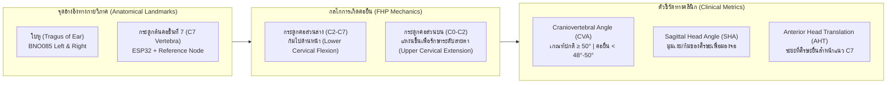
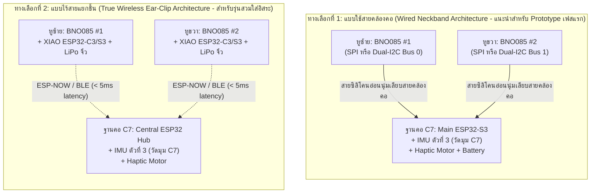

# Base Plan: ระบบตรวจวัดและแจ้งเตือนภาวะคอยื่น (Forward Head Posture / Office Syndrome) ด้วย Dual Ear-Mounted BNO085 และ ESP32 ที่กระดูก C7

---

## 1. ภาพรวมโครงการ (Executive Summary & Project Vision)

โครงการนี้มุ่งเน้นการพัฒนาระบบอุปกรณ์สวมใส่อัจฉริยะ (Wearable Healthcare & Ergonomic Device) เพื่อตรวจจับ วิเคราะห์ และแจ้งเตือน **ภาวะคอยื่นไปด้านหน้า (Forward Head Posture - FHP)** ซึ่งเป็นสาเหตุหลักของกลุ่มอาการ **Office Syndrome** (เช่น อาการปวดคอ บ่า ไหล่เรื้อรัง หรือ Upper Crossed Syndrome) ในกลุ่มคนทำงานออฟฟิศและผู้ใช้คอมพิวเตอร์/สมาร์ทโฟนเป็นเวลานาน

### แนวคิดหลักของสถาปัตยกรรม (Core Concept)
แทนที่จะใช้กล้องวงจรปิด (Computer Vision) ซึ่งมีข้อจำกัดด้านความเป็นส่วนตัว (Privacy) และมุมกล้องที่ต้องตั้งอยู่ด้านข้างตลอดเวลา หรือการใช้เซ็นเซอร์ติดที่หลังเพียงจุดเดียวซึ่งแยกแยะการก้มหน้าออกจากภาวะคอยื่นได้ยาก ระบบนี้จึงจำลองการวัดมุมมาตรฐานทางการแพทย์ที่เรียกว่า **Craniovertebral Angle (CVA)** และ **Sagittal Head Angle (SHA)** โดยใช้อ้างอิงทางกายวิภาค (Anatomical Landmarks) 2 ส่วนหลัก:
1. **บริเวณใบหูทั้งสองข้าง (Left & Right Ears / Tragus):** ติดตั้งเซ็นเซอร์ **9-DOF IMU (BNO085)** จำนวน 2 ตัว (ซ้าย-ขวา) เพื่อวัดการวางตัวของศีรษะใน 3 มิติ (Head Orientation) และใช้ข้อมูลคู่ขนาน (Bilateral Fusion) ในการกรองสัญญาณรบกวนจากการขยับใบหน้า/ขากรรไกร
2. **บริเวณปุ่มกระดูกสันหลังส่วนคอชิ้นที่ 7 (C7 Spinous Process):** ติดตั้งไมโครคอนโทรลเลอร์หลัก **ESP32** (พร้อม IMU อ้างอิงที่ฐานคอ หรือเป็นโหนดรับข้อมูลและวัดความเอียงของลำตัวส่วนบน) เพื่อเป็นจุดอ้างอิงฐานคอ (Cervicothoracic Junction Reference)

---

## 2. พื้นฐานทางชีวกลศาสตร์และการแพทย์ (Biomechanical & Clinical Foundation)

ในการวิจัยทางการแพทย์และกายภาพบำบัด การประเมินภาวะคอยื่น (Forward Head Posture - FHP) ใช้ตัวชี้วัดหลักในระนาบข้าง (Sagittal Plane) ดังนี้:



### 2.1 ตัวชี้วัดมาตรฐาน (Standard Clinical Angles)
1. **Craniovertebral Angle (CVA):**
   - **นิยาม:** มุมที่เกิดจากเส้นแนวนอน (Horizontal Line) ที่ลากผ่านปุ่มกระดูก **C7** กับเส้นที่ลากเชื่อมระหว่างปุ่มกระดูก **C7 ไปยังติ่งหู (Tragus of the Ear)**
   - **เกณฑ์ทางคลินิก (Clinical Thresholds):**
     - **ท่าทางปกติ (Normal Posture):** $\text{CVA} \ge 50^\circ - 53^\circ$
     - **ภาวะคอยื่นระดับเริ่มต้นถึงปานกลาง (Mild-to-Moderate FHP):** $\text{CVA}$ อยู่ระหว่าง $40^\circ - 48^\circ$
     - **ภาวะคอยื่นระดับรุนแรง (Severe FHP):** $\text{CVA} < 40^\circ$
2. **Sagittal Head Angle (SHA) / Head Tilt Angle:**
   - **นิยาม:** มุมของเส้นที่ลากจากหางตาไปยังติ่งหูเทียบกับแนวระนาบ
   - **ความสำคัญ:** เมื่อเกิดภาวะคอยื่น (FHP) กระดูกคอส่วนล่าง (Lower Cervical: C2–C7) จะเกิดการก้ม (Flexion) ยื่นไปข้างหน้า แต่ร่างกายจะชดเชยด้วยการแหงนกระดูกคอส่วนบน (Upper Cervical / Craniocervical: C0–C2 Extension) เพื่อให้ดวงตายังคงมองจอคอมพิวเตอร์ในแนวระดับได้
3. **ภาระน้ำหนักต่อกระดูกต้นคอ (Biomechanical Load - Hansraj's Model):**
   - ศีรษะมนุษย์ปกติหนักประมาณ $4.5 - 5.5\text{ kg}$ เมื่ออยู่ในแนวตรง ($0^\circ$)
   - เมื่อคอยื่นหรือก้มไปด้านหน้าเพียง $15^\circ$ แรงกดที่กระดูกคอ C7 จะเพิ่มขึ้นเป็น $\sim 12\text{ kg}$ ที่ $30^\circ$ เพิ่มเป็น $\sim 18\text{ kg}$ และที่ $45^\circ$ สูงถึง $\sim 22\text{ kg}$ ซึ่งเป็นต้นเหตุของกล้ามเนื้ออักเสบเรื้อรังและหมอนรองกระดูกคอเสื่อม

---

## 3. Deep Research: งานวิจัยและวรรณกรรมที่เกี่ยวข้อง (Literature Review)

จากการค้นคว้างานวิจัยระดับนานาชาติ (IEEE, MDPI Sensors, Applied Sciences, Symmetry) ที่ศึกษาการใช้ IMU วัดท่าทางของศีรษะและกระดูกคอ C7 สามารถสรุปกลุ่มงานวิจัยสำคัญที่เป็นรากฐานของโปรเจคนี้ได้ดังนี้:

### 3.1 ตารางสรุปงานวิจัยหลัก (Key Research Papers Synthesis)

| งานวิจัย (Title / Authors / Year / Journal) | รูปแบบการติดเซ็นเซอร์ (Sensor Setup) | ระเบียบวิธีและอัลกอริทึม (Methodology) | ข้อค้นพบและจุดที่นำมาประยุกต์ใช้ในโปรเจคนี้ |
| :--- | :--- | :--- | :--- |
| **1. Real-Time Forward Head Posture Detection and Correction System Utilizing an IMU Sensor**<br/>*G. Park & I. Y. Jung (2024)*, **MDPI Applied Sciences** (Vol. 14, 9075) | ติดตั้ง IMU บริเวณรอยต่อกระดูกคอและหลังส่วนบน (Cervicothoracic junction / C7) เชื่อมต่อกับไมโครคอนโทรลเลอร์ | ใช้เวกเตอร์ความเร่งโน้มถ่วง (Gravity Acceleration Vector) แทนการอินทิเกรต Gyroscope เพียวๆ เพื่อลด Drift; แจ้งเตือนเมื่อคอยื่นต่อเนื่อง $>10$ วินาที | พิสูจน์ว่าการตรวจจับ FHP แบบ Real-time พร้อมการแจ้งเตือน (Biofeedback) ช่วยเพิ่มค่ามุม CVA ของผู้ใช้งานได้อย่างมีนัยสำคัญ และการใช้ Time-window ($>10\text{ s}$) ช่วยลด False Alarm |
| **2. Applying ‘Earable’ Inertial Sensing for Real-time Head Posture Detection**<br/>*M. Radhakrishnan, K. Misra, & V. Ravichandran (2021)*, **IEEE PerCom Workshops** | ใช้ IMU ที่ติดตั้งบริเวณใบหู (Earable / Ear-worn IMU) | วิเคราะห์ท่าทางของศีรษะ (Head Pitch, Roll, Yaw) และการเคลื่อนไหวของศีรษะในขณะนั่งทำงานหน้าโต๊ะคอมพิวเตอร์แบบ Real-time | ยืนยันว่าตำแหน่งใบหู (Ear-mounted) ยึดติดกับกะโหลกศีรษะโดยตรง (Rigidly attached to skull) ให้ความแม่นยำในการวัดมุมศีรษะสูงกว่าการติดที่กล้ามเนื้อคอที่มีการเลื่อนไหลของผิวหนัง |
| **3. The Validity of Wireless Earbud-Type Wearable Sensors for Head Angle Estimation...**<br/>*A.-R. Kim et al. (2022)*, **MDPI Sensors** | เซ็นเซอร์ไร้สายรูปแบบติดหู (Wireless Ear-IMU) เทียบกับระบบกล้อง Optical Motion Capture มาตรฐาน | เปรียบเทียบความแม่นยำ (Concurrent Validity) ของมุมศีรษะใน 3 ระนาบ (Sagittal, Frontal, Transverse) จาก Ear-IMU เทียบกับกล้อง 3D | ค่าสหสัมพันธ์ (Correlation) ระหว่าง Ear-IMU และระบบ Motion Capture สูงมาก พิสูจน์ว่าเซ็นเซอร์ที่หูใช้แทนจุด Anatomical Landmark (Tragus) ได้อย่างแม่นยำ |
| **4. Kinematic Analysis of the Forward Head Posture Associated with Smartphone Use**<br/>*J. Fercho et al. (2023)*, **MDPI Symmetry** | ใช้ Multi-IMU ติดตามแนวกระดูกสันหลังส่วนคอ: จุดอ้างอิงที่ **C7** และจุดด้านบนใกล้ฐานกะโหลก/หลังใบหู (Mastoid process) | แยกวิเคราะห์การเคลื่อนไหวของคอส่วนล่าง (Subaxial C2–C7) และคอส่วนบน (Craniocervical C0–C1) | ชี้ให้เห็นว่าคนที่มีอาการ FHP จะมีการก้มที่ระดับ C7/คอส่วนล่าง ในขณะที่ศีรษะอาจจะตั้งตรงเพื่อมองจอ การใช้เซ็นเซอร์ทั้งที่ **ระดับหู/กะโหลก** ร่วมกับ **ระดับ C7** จึงจำเป็นเพื่อแยกแยะ **"ก้มหน้า (Neck Flexion)"** ออกจาก **"คอยื่นแต่ตามองตรง (True FHP / Protraction)"** |
| **5. Anatomy-Based Assessment of Spinal Posture Using IMU Sensors and Machine Learning**<br/>*R. Koca & Y. B. Koca (2025)*, **MDPI Sensors** | ติดตั้ง IMU ตามจุดกระดูกสันหลังสำคัญ ได้แก่ **C1/Head, C7**, T5, T12, L5 | คำนวณมุมสัมพัทธ์ระหว่างข้อต่อ (Relative Segmental Angles เช่น C1–C7) ร่วมกับโมเดล Machine Learning (Random Forest / ANN) เพื่อทำนายความผิดปกติของแนวกระดูก | การใช้ความสัมพันธ์ระหว่างมุมของศีรษะ (C1/Ear) และฐานคอ (C7) สามารถแปลง (Map) ไปเป็นค่าประมาณของ CVA ($\widehat{\text{CVA}}$) และความโค้งของกระดูกคอ (Cervical Lordosis) ได้แม่นยำกว่าการใช้เกณฑ์ Threshold เชิงเดี่ยว |

### 3.2 ช่องว่างทางวิชาการและจุดเด่นของระบบเรา (Research Gap & Our Unique Value Proposition)
งานวิจัยส่วนใหญ่มีข้อจำกัดอย่างใดอย่างหนึ่งต่อไปนี้:
1. **แบบใช้ IMU ตัวเดียวที่ C7 หรือที่หู:**
   - หากติดที่ **หูอย่างเดียว**: เมื่อผู้ใช้ยื่นคอไปข้างหน้าแต่สายตามองจอตรงๆ (Protraction) มุม Pitch ของศีรษะแทบไม่เปลี่ยน ($\approx 0^\circ$) ทำให้ตรวจจับอาการคอยื่นแบบมองตรงไม่ได้!
   - หากติดที่ **C7 อย่างเดียว**: ไม่สามารถแยกได้ว่าผู้ใช้กำลังเอนหลังพิงเก้าอี้ ก้มลำตัว หรือยื่นเฉพาะศีรษะออกไป
2. **ทำไมต้องใช้ BNO085 ที่หูซ้าย + หูขวา (Bilateral Ear IMUs) ร่วมกับจุดอ้างอิง C7?**
   - **การแยกแยะท่าทางแบบลูกโซ่จลนศาสตร์ (Two-Link Kinematic Chain):** เมื่อมีข้อมูลทั้งที่ **C7 (ฐานคอ)** และ **ใบหู (ศีรษะ)** ระบบจะเห็นความต่างศักย์ของมุม ($\Delta\theta = \theta_{\text{Head}} - \theta_{\text{C7}}$) ทำให้ตรวจจับได้ทั้ง **"ก้มคอเล่นมือถือ (Text Neck)"** และ **"คอยื่นจ้องจอคอมฯ (Office Syndrome FHP)"**
   - **การตรวจจับความไม่สมดุลซ้าย-ขวา (Bilateral Symmetry & Roll/Yaw Compensation):** อาการ Office Syndrome ไม่ได้มีแค่คอยื่นด้านหน้า แต่รวมถึงการเอียงคอไปข้างใดข้างหนึ่งเป็นเวลานาน (Lateral Tilt / Roll) หรือการหันคอไปมองจอที่สองค้างไว้ (Sustained Axial Rotation / Yaw) การติดที่หูซ้ายและขวาช่วยให้วัดความสมดุลซ้าย-ขวาได้อย่างสมบูรณ์
   - **การตัดสัญญาณรบกวน (Artifact Rejection):** เมื่อผู้ใช้อ้าปากพูด เคี้ยวอาหาร หรือขยับขาไกรรไกร เซ็นเซอร์ข้างใดข้างหนึ่งอาจเกิดการสั่นไหว การนำควอเทอร์เนียนของหูซ้าย ($\mathbf{q}_L$) และหูขวา ($\mathbf{q}_R$) มาทำ **Spherical Linear Interpolation (SLERP) / Bilateral Averaging** จะช่วยหักล้างความคลาดเคลื่อนและได้จุดกึ่งกลางกะโหลกศีรษะเสมือน (Virtual Mid-Tragus Axis) ที่นิ่งและแม่นยำ

---

## 4. โมเดลคณิตศาสตร์และอัลกอริทึมการคำนวณ (Mathematical & Kinematic Model)

> [!IMPORTANT]
> **ข้อเท็จจริงทางฟิสิกส์ที่ต้องเข้าใจ:** เซ็นเซอร์ IMU (Accelerometer + Gyroscope + Magnetometer) วัดได้เฉพาะ **มุมการหมุน (Orientation)** และ **ความเร่งเชิงเส้น (Linear Acceleration)** แต่ไม่สามารถวัดระยะกระจัดสัมบูรณ์ (Absolute Distance) เป็นเซนติเมตรได้โดยตรงเพราะการอินทิเกรตความเร่งสองครั้ง ($\iint a\,dt^2$) จะเกิด Drift มหาศาลภายในไม่กี่วินาที ดังนั้น การคำนวณค่า CVA และระยะคอยื่น (AHT) จึงต้องใช้ **Rigid-Link Kinematic Chain Model** ร่วมกับ **Sensor Fusion Quaternions** ของ BNO085

### 4.1 การล็อกพิกัดเริ่มต้นเป็นแหล่งอ้างอิงและการแก้ปัญหา Diff/Drift (Origin-Referenced Calibration & Drift Compensation)
เนื่องจากรูปร่างใบหู มุมการเกี่ยวของอุปกรณ์ และความโค้งของแผ่นหลังบริเวณ C7 ของแต่ละคนไม่เท่ากัน รวมถึงปัญหาค่าเพี้ยนสะสม (Gyro Drift / Mounting Diff) เมื่อใช้งานต่อเนื่อง ระบบจึงใช้กลไก **Origin Location Reference ($O_{\text{origin}}$)** ในการ Calibrate และหักล้างความคลาดเคลื่อนดังนี้:

1. **การกำหนดจุดกำเนิดพิกัดที่กระดูก C7 และบันทึก Origin State ($t = t_0$):**
   - กำหนดให้ตำแหน่งของโหนด ESP32 ที่ปุ่มกระดูก **C7 เป็นจุดกำเนิดพิกัดอ้างอิง $\mathbf{P}_{C7,\text{origin}} = (0, 0, 0)$**
   - เมื่อผู้ใช้นั่งในท่าเริ่มต้นที่ถูกต้อง (Neutral Posture) และกดปุ่ม Calibrate ระบบจะล็อกค่า Quaternion ตั้งต้นของทั้ง 3 โหนด ($\mathbf{q}_{L,\text{origin}}, \mathbf{q}_{R,\text{origin}}, \mathbf{q}_{C7,\text{origin}}$) และคำนวณพิกัดเริ่มต้นของจุดกึ่งกลางใบหูเทียบกับ C7 ($\mathbf{P}_{\text{Ear},\text{origin}}$) เก็บไว้เป็นแหล่งอ้างอิงหลักของการทดสอบ
2. **การตัดความต่างของมุมติดตั้ง (Mounting Diff Tare):**
   - ทุกๆ เฟรมเวลา $t$ ค่าการหมุนของเซ็นเซอร์แต่ละตัว $i \in \{L, R, C7\}$ จะถูกคำนวณเป็นค่าความต่างสัมพัทธ์กับจุดเริ่มต้น ($O_{\text{origin}}$) ทันที:
     $$\mathbf{q}_{i,\text{cal}}(t) = \mathbf{q}_{i,\text{origin}}^{-1} \otimes \mathbf{q}_{i,\text{raw}}(t)$$
     *(โดยที่ $\otimes$ คือตัวดำเนินการคูณ Quaternion และ $\mathbf{q}^{-1} = \mathbf{q}^* = [q_w, -q_x, -q_y, -q_z]^T$ สำหรับ Unit Quaternion)*
3. **การตรวจสอบและหักล้างอาการ Drift สะสมเทียบกับจุด Origin (Origin-Checked Drift Nulling):**
   - **Gravity & Origin Return Check:** เมื่อผู้ใช้กลับมาอยู่ในสภาวะนิ่งใกล้โซนท่าทางเริ่มต้น (ความเร่งเชิงมุม $\|\vec{\omega}\| < \epsilon_\omega$ และทิศทางเวกเตอร์แรงโน้มถ่วง $\vec{g}$ ตรงกับระนาบ Origin) ระบบจะตรวจจับค่าความเพี้ยนสะสม ($\Delta\mathbf{q}_{\text{drift}}$) ที่เบี่ยงเบนไปจาก $\mathbf{q}_{\text{origin}}$ และทำการดึงค่า Drift กลับเข้าสู่ศูนย์โดยอัตโนมัติ
   - **Differential Yaw Referencing:** เพื่อป้องกันอาการ Yaw Drift และตัดผลกระทบจากการหมุนเก้าอี้ทำงาน ระบบจะคำนวณมุมหันหน้าซ้าย-ขวาสัมพัทธ์กับฐานคอ C7 เสมอ ($\Delta\psi = \psi_{\text{Head}} - \psi_{C7}$)

### 4.2 การหลอมรวมข้อมูลหูซ้ายและหูขวา (Bilateral Ear Sensor Fusion)
เมื่อได้ $\mathbf{q}_{L,\text{cal}}(t)$ และ $\mathbf{q}_{R,\text{cal}}(t)$ ที่ปรับแกนให้ตรงกันแล้ว:
1. **ตรวจสอบความสอดคล้อง (Rigid-Body Coherence Check):**
   เนื่องจากหูซ้ายและหูขวาอยู่บนกะโหลกศีรษะเดียวกัน มุมการหมุนของทั้งคู่จะต้องสอดคล้องกัน คำนวณมุมความต่าง:
   $$\delta\theta_{LR} = 2 \arccos\left(\left| \mathbf{q}_{L,\text{cal}} \cdot \mathbf{q}_{R,\text{cal}} \right|\right)$$
   หาก $\delta\theta_{LR} > \tau_{\text{slip}}$ (เช่น $> 10^\circ$) แสดงว่าตัวเกี่ยวหูข้างใดข้างหนึ่งหลวมหรือขยับ ระบบจะแจ้งเตือนให้จัดตำแหน่งเซ็นเซอร์ใหม่
2. **คำนวณค่าเฉลี่ยจุดกึ่งกลางศีรษะ (Virtual Head Center Orientation $\mathbf{q}_{\text{Head}}$):**
   ใช้ **SLERP (Spherical Linear Interpolation)** ที่จุดกึ่งกลาง ($t = 0.5$):
   $$\mathbf{q}_{\text{Head}}(t) = \text{SLERP}\left(\mathbf{q}_{L,\text{cal}}(t), \mathbf{q}_{R,\text{cal}}(t), 0.5\right)$$

### 4.3 การแปลงเป็นมุมกายวิภาคและประมาณค่า CVA (CVA & AHT Estimation)
จาก $\mathbf{q}_{\text{Head}}(t)$ และ $\mathbf{q}_{C7,\text{cal}}(t)$ เราสามารถดึงมุม Euler ตามลำดับการหมุนทางชีวกลศาสตร์:
- $\theta_{\text{Head}}$ (Head Pitch): มุมก้ม/เงยของศีรษะเทียบกับแนวตั้งต้น
- $\phi_{\text{Head}}$ (Head Roll): มุมเอียงคอซ้าย/ขวา
- $\psi_{\text{Head}}$ (Head Yaw): มุมหันหน้าซ้าย/ขวา (คำนวณสัมพัทธ์กับ C7 เพื่อตัดผลจากการหมุนเก้าอี้ทำงาน)
- $\theta_{C7}$ (Cervicothoracic Pitch): มุมก้ม/โน้มไปด้านหน้าของฐานคอ C7 และกระดูกอกส่วนบน

**โมเดลลูกโซ่จลนศาสตร์ 2 ท่อน (2-Link Sagittal Kinematic Model):**
กำหนดให้ความยาวกระดูกคอเฉลี่ยจาก C7 ถึงจุดหมุนฐานกะโหลก (C0/Tragus) คือ $L_{\text{neck}}$ (ค่าเฉลี่ยผู้ใหญ่ประมาณ $10 - 13\text{ cm}$ หรือปรับตามส่วนสูงผู้ใช้):
1. **การประมาณระยะคอยื่นไปด้านหน้า (Estimated Anterior Head Translation - $\widehat{\text{AHT}}$):**
   $$\widehat{\text{AHT}}(t) = L_1 \sin(\theta_{C7}) + L_2 \sin(\theta_{\text{Head}})$$
   *(หรือในกรณีที่ผู้ใช้ยื่นคอไปข้างหน้าโดยตรง กระดูกช่วง C7–T1 จะเกิดการงอตัวไปด้านหน้า $\Delta\theta_{C7} > 0$ ในขณะที่ $\theta_{\text{Head}} \approx 0$ หรือแหงนขึ้นเล็กน้อย $\theta_{\text{Head}} < 0$)*
2. **การประมาณค่ามุม CVA แบบไดนามิก ($\widehat{\text{CVA}}$):**
   $$\widehat{\text{CVA}}(t) = \text{CVA}_0 - \left( \alpha \cdot \Delta\theta_{C7}(t) + \beta \cdot \Delta\theta_{\text{Head}}(t) \right)$$
   โดยที่:
   - $\text{CVA}_0$: ค่ามุม CVA มาตรฐานในขณะตั้งตรง (ค่าเริ่มต้น $52^\circ$ หรือวัดจริงจากภาพถ่ายด้านข้างตอน Calibrate ครั้งแรก)
   - $\alpha, \beta$: ค่าสัมประสิทธิ์ถ่วงน้ำหนัก (Kinematic Regression Weights) ที่ได้จากการทดลองเทียบกับมุมกล้อง (Photogrammetry)

### 4.4 ตารางจำแนกสถานะท่าทาง (Posture State Classification Matrix)

| รูปแบบท่าทาง (Posture Pattern) | มุมฐานคอ ($\Delta\theta_{C7}$) | มุมศีรษะ ($\Delta\theta_{\text{Head}}$) | ค่ามุมสัมพัทธ์ ($\theta_{\text{Head}} - \theta_{C7}$) | ความหมายทางคลินิก (Clinical Interpretation) |
| :--- | :---: | :---: | :---: | :--- |
| **1. Neutral (นั่งถูกหลักสรีรศาสตร์)** | $\approx 0^\circ$ ($\pm 5^\circ$) | $\approx 0^\circ$ ($\pm 5^\circ$) | $\approx 0^\circ$ | ศีรษะตั้งตรงอยู่เหนือจุด C7 พอดี |
| **2. Pure Forward Head Posture (คอยื่นจ้องจอคอมฯ)** | **เพิ่มขึ้นสูง** ($> +8^\circ$ ถึง $+15^\circ$) | **คงที่หรือแหงนขึ้น** ($\le 0^\circ$ ถึง $-10^\circ$) | **ติดลบชัดเจน** (Craniocervical Extension) | **Office Syndrome เป้าหมายหลัก:** คอส่วนล่างยื่นไปข้างหน้า แต่แหงนหน้ามองจอ |
| **3. Text Neck / Cervical Flexion (ก้มหน้าดูมือถือ/เอกสาร)** | เพิ่มขึ้นปานกลาง ($+5^\circ$ ถึง $+12^\circ$) | **ก้มลงชัดเจน** ($> +15^\circ$ ถึง $+45^\circ$) | เป็นบวกมาก (Flexion) | ก้มคอทั้งส่วนบนและส่วนล่าง รับน้ำหนักกดทับสูง |
| **4. Thoracic Slouching (นั่งหลังค่อม/ไหล่ห่อ)** | **เพิ่มขึ้นมาก** ($> +15^\circ$) | ก้มตามหรือชดเชย | แปรผัน | ลำตัวส่วนบนและ C7 โน้มไปข้างหน้า |
| **5. Lateral Tilt / Off-Center Gaze (คอเอียง/หันมองจอเสริมค้าง)** | ปกติ | $|\Delta\phi_{\text{Roll}}| > 10^\circ$ หรือ $|\Delta\psi_{\text{Yaw}}| > 20^\circ$ | เบี่ยงเบนแนวแกนข้าง/หมุน | เสี่ยงต่อกล้ามเนื้อคอและบ่าตึงตัวข้างเดียว (Unilateral Strain) |

---

## 5. สถาปัตยกรรมระบบฮาร์ดแวร์และการเชื่อมต่อ (Hardware & Communication Architecture)

### 5.1 ทำไม BNO085 ถึงเหมาะสมที่สุดสำหรับโปรเจคนี้?
ชิป **BNO085** (จาก CEVA / Hillcrest Labs) ไม่ได้เป็นเพียงเซ็นเซอร์ดิบเหมือน MPU6050 แต่มีโปรเซสเซอร์ **32-bit ARM Cortex-M0+** รันอัลกอริทึม **SH-2 Sensor Fusion Firmware** อยู่ในตัว:
- ให้ค่า **Quaternion 4 มิติ** ที่ผ่านการชดเชย Drift เรียบร้อยแล้วสูงสุดถึง $400\text{ Hz}$
- โหมด **`SH2_ARVR_STABILIZED_RV`** และ **`SH2_GAME_ROTATION_VECTOR`** ไม่พึ่งพาสนามแม่เหล็กโลกในการคำนวณแกน Pitch/Roll จึง **ไม่ได้รับผลกระทบจากสนามแม่เหล็กของลำโพงหูฟัง โต๊ะทำงานเหล็ก หรือหน้าจอคอมพิวเตอร์**

### 5.2 ทางเลือกสถาปัตยกรรมการส่งข้อมูลจากหูซ้าย-ขวามายัง ESP32 ที่ C7

เนื่องจากโจทย์ระบุว่า **"ติด BNO085 2 ตัวที่หูซ้ายขวา และส่งข้อมูลพิกัดไปยัง ESP32 ที่กระดูก C7"** ในทางวิศวกรรมสมองกลฝังตัว มีสถาปัตยกรรมที่ทำได้จริง 2 รูปแบบหลัก (เปรียบเทียบข้อดี-ข้อเสียเพื่อให้เลือกใช้งานตามระยะการพัฒนา):



#### เปรียบเทียบทางเทคนิคระหว่าง Option A (Wired Neckband) และ Option B (True Wireless)

| ปัจจัยเปรียบเทียบ | Option A: Wired Neckband (เดินสายจากหูลงมาที่ C7) | Option B: True Wireless (ใช้ MCU จิ๋วที่หูส่งไร้สายมา C7) |
| :--- | :--- | :--- |
| **น้ำหนักที่ใบหู** | **เบามาก ($\sim 2-3\text{ กรัม/ข้าง}$)** เพราะที่หูมีเฉพาะบอร์ด BNO085 เพียวๆ | หนักกว่า ($\sim 12-18\text{ กรัม/ข้าง}$) เพราะต้องมี MCU จิ๋ว + แบตเตอรี่ที่หูแต่ละข้าง |
| **การจัดการพลังงาน** | **ชาร์จจุดเดียวที่ C7** ใช้แบตเตอรี่ก้อนเดียวที่ฐานคอ อยู่ได้นาน $12-24\text{ ชม.}$ | ต้องชาร์จแยก 3 จุด (หูซ้าย, หูขวา, และโหนด C7) |
| **ความซับซ้อนและการซิงค์เวลา** | ข้อมูลอ่านจาก MCU ตัวเดียวกันที่ C7 จึง **ซิงค์เวลาตรงกันระดับไมโครวินาที** | ต้องทำ Timestamp Synchronization ผ่านโปรโตคอล **ESP-NOW** |
| **ข้อควรระวังทางวิศวกรรม** | ต้องใช้สายไฟชนิดอ่อนตัวสูง (Ultra-flexible Silicone Wire) เพื่อไม่ให้สายดึงรั้งใบหู | ใช้ต้นทุนฮาร์ดแวร์สูงขึ้นและต้องออกแบบเคสเกี่ยวหู (Ear-hook) ให้สมดุล |

> [!WARNING]
> **ข้อควรระวังสำคัญเรื่องโปรโตคอล I2C ของ BNO085 กับ ESP32:**
> ชิป BNO085 ใช้กลไก **I2C Clock Stretching** และโปรโตคอล SHTP ขนาดแพ็กเกจใหญ่ ซึ่งมักเกิดปัญหาค้าง (Bus Lockup) กับไดรเวอร์ I2C ของ ESP32 รุ่นเก่าหากต่อผ่าน Multiplexer (เช่น TCA9548A)
> **แนวทางแก้ไขที่เสถียรที่สุด:**
> 1. **หากใช้การต่อสาย (Option A):**
>    - **วิธีที่เสถียรที่สุด (Recommended):** ใช้โหมด **SPI** ร่วมกัน (ใช้สาย SCK, MISO, MOSI ร่วมกัน และแยกขา `CS`, `INT`, `RST` ของแต่ละตัว)
>    - **วิธีทางเลือกรอง (Dual Hardware I2C + ADR Pin):** ESP32 มีพอร์ต I2C ฮาร์ดแวร์ 2 ชุด (`Wire` และ `Wire1`) และ BNO085 สามารถเปลี่ยน Address จาก `0x4A` เป็น `0x4B` ได้โดยการดึงขา `ADR/DI` ขึ้น `3.3V` พร้อมตั้งความเร็ว I2C ที่ $400\text{ kHz}$ และต่อขา `INT` กับ `RST` เข้า GPIO ทุกตัว
> 2. **หากเพิ่มการวัดมุมที่ C7 โดยตรง:** แนะนำให้ติดตั้ง **IMU ตัวที่ 3 ไว้ในกล่องเดียวกับ ESP32 ที่กระดูก C7** เพื่อให้คำนวณความต่างมุมระหว่าง **หู (Tragus)** กับ **กระดูก C7** ได้อย่างสมบูรณ์แบบตามนิยามของมุม CVA

### 5.3 คู่มือการต่อวงจรและจ่ายไฟ Prototype บน Breadboard (Breadboard Wiring & Pinout Guide)

สำหรับการทำ Prototype ทดสอบบน Breadboard ร่วมกับ **ESP32 DevKit V1 (30 หรือ 38 ขา)** และโมดูล **BNO085 (เช่น Adafruit BNO085 หรือ GY-BNO085)** มีกฎเหล็กสำคัญคือ **ห้ามจ่ายไฟ 5V เข้าขา VIN/VCC ของบอร์ด GY-BNO085 ที่ไม่มี Regulator เด็ดขาด ให้ใช้ไฟ `3.3V` จาก ESP32 ร่วมกันทั้งระบบ**

#### รูปแบบที่ 1: การต่อบน Breadboard แบบ I2C (แนะนำสำหรับการขึ้นต้นแบบเร็ว — ใช้สายน้อยที่สุด)
เนื่องจาก BNO085 มี 2 ตัวบนบัส I2C เดียวกัน เราต้องแยก **I2C Address** ของหูซ้ายและหูขวาด้วยขา `DI` (หรือขา `ADR` บนบอร์ด Adafruit):
- **BNO085 ตัวที่ 1 (หูซ้าย):** ปล่อยขา `ADR/DI` ลง `GND` (หรือลอยไว้) $\rightarrow$ ได้ Address **`0x4A`**
- **BNO085 ตัวที่ 2 (หูขวา):** จั๊มพ์ขา `ADR/DI` เข้ากับไฟ **`3.3V`** $\rightarrow$ ได้ Address **`0x4B`**
- **ขา `PS0` และ `PS1`:** ต้องต่อลง `GND` ทั้งคู่ (บนบอร์ดสำเร็จรูปมักดึงลง GND ไว้ให้แล้วเพื่อเลือกโหมด I2C)

| อุปกรณ์ / โมดูล | ขาของโมดูล (Pin) | ต่อเข้ากับขา ESP32 (Pin) | คำอธิบายและการเดินไฟบน Breadboard |
| :--- | :--- | :--- | :--- |
| **รางไฟ Breadboard** | รางบวก (`+` สีแดง) | **`3V3` (3.3V)** | จ่ายไฟเลี้ยงหลัก 3.3V ให้เซ็นเซอร์ทุกตัว |
| **รางกราวด์ Breadboard** | รางลบ (`-` สีน้ำเงิน) | **`GND`** | กราวด์ร่วม (Common Ground) ของทั้งระบบ |
| **BNO085 #1 (หูซ้าย `0x4A`)** | `VIN` / `VCC`<br>`GND`<br>`SDA`<br>`SCL`<br>`DI` / `ADR`<br>`INT`<br>`RST` | รางไฟ **`3.3V`**<br>ราง **`GND`**<br>**`GPIO 21`** (I2C SDA)<br>**`GPIO 22`** (I2C SCL)<br>ต่อลง **`GND`** (Address `0x4A`)<br>**`GPIO 18`**<br>**`GPIO 19`** | ใช้ไฟ 3.3V<br>กราวด์ร่วม<br>สายข้อมูล I2C (พ่วงกับตัวที่ 2)<br>สายนาฬิกา I2C (พ่วงกับตัวที่ 2)<br>กำหนดรหัสประจำตัวหูซ้าย = `0x4A`<br>ขาแจ้งเตือนข้อมูลพร้อมอ่าน (ช่วยให้ไม่ค้าง)<br>ขารีเซ็ตฮาร์ดแวร์ |
| **BNO085 #2 (หูขวา `0x4B`)** | `VIN` / `VCC`<br>`GND`<br>`SDA`<br>`SCL`<br>`DI` / `ADR`<br>`INT`<br>`RST` | รางไฟ **`3.3V`**<br>ราง **`GND`**<br>**`GPIO 21`** (I2C SDA)<br>**`GPIO 22`** (I2C SCL)<br>ต่อขึ้น **`3.3V`** (Address `0x4B`)<br>**`GPIO 16`**<br>**`GPIO 17`** | ใช้ไฟ 3.3V<br>กราวด์ร่วม<br>พ่วงเส้นเดียวกับ `GPIO 21`<br>พ่วงเส้นเดียวกับ `GPIO 22`<br>กำหนดรหัสประจำตัวหูขวา = `0x4B`<br>ขา Interrupt แยกเฉพาะหูขวา<br>ขารีเซ็ตแยกเฉพาะหูขวา |
| **มอเตอร์สั่นเตือน (ที่ C7)** | ขั้วบวกมอเตอร์ (`+`)<br>ขั้วลบมอเตอร์ (`-`)<br>ขา `Gate/Base` ทรานซิสเตอร์ | รางไฟ **`3.3V`**<br>ขา `Collector/Drain` ของ `2N2222`/`MOSFET`<br>**`GPIO 25`** (ผ่าน R $1\text{ k}\Omega$) | ห้ามต่อมอเตอร์เข้าขา GPIO โดยตรงเพราะกินกระแสเกิน $40\text{ mA}$ ต้องขับผ่านทรานซิสเตอร์ `2N2222` หรือโมดูล MOSFET พร้อมไดโอดกันไฟย้อน (`1N4148`) |

---

#### รูปแบบที่ 2: การต่อบน Breadboard แบบ SPI (เสถียรสูงสุด ไม่เกิดปัญหา I2C Clock Stretching)
หากต้องการความเสถียรระดับ Industrial/Medical แนะนำให้ใช้โหมด **SPI** โดยจั๊มพ์ขา **`PS0 = 3.3V`** และ **`PS1 = 3.3V`** บน BNO085 ทั้ง 2 ตัว:
- **ขาร่วมกัน (Shared SPI Bus):**
  - `SCL/SCK` $\rightarrow$ **`GPIO 18`** (VSPI SCK)
  - `SDA/MISO` $\rightarrow$ **`GPIO 19`** (VSPI MISO)
  - `DI/MOSI` $\rightarrow$ **`GPIO 23`** (VSPI MOSI)
- **ขาแยกเฉพาะแต่ละตัว (Dedicated Pins):**
  - **หูซ้าย (BNO085 #1):** `CS` $\rightarrow$ **`GPIO 5`**, `INT` $\rightarrow$ **`GPIO 4`**, `RST` $\rightarrow$ **`GPIO 2`**
  - **หูขวา (BNO085 #2):** `CS` $\rightarrow$ **`GPIO 15`**, `INT` $\rightarrow$ **`GPIO 16`**, `RST` $\rightarrow$ **`GPIO 17`**

---

## 6. การออกแบบระบบซอฟต์แวร์และอัลกอริทึมแจ้งเตือน (Firmware, Software & Biofeedback Pipeline)

### 6.1 โครงสร้างการทำงานของ Firmware บน ESP32 (FreeRTOS Multi-Tasking)
เพื่อให้การอ่านค่าเซ็นเซอร์ความเร็วสูงไม่ถูกขัดจังหวะโดยการส่งข้อมูลไร้สายหรือการทำงานของมอเตอร์สั่น ควรแบ่ง Task บน ESP32 (Dual-Core) ดังนี้:
- **Core 1 (Real-Time Sensor & Kinematics Task - $50\text{ Hz}$):**
  - อ่านค่า Quaternion จาก BNO085 (หูซ้าย, หูขวา) และ IMU ที่ C7
  - คำนวณ SLERP Fusion, Relative Angles ($\Delta\theta_{C7}, \Delta\theta_{\text{Head}}$), และค่าประมาณ $\widehat{\text{CVA}}$
  - กรองสัญญาณความถี่สูงจากการเคลื่อนไหวชั่วคราวด้วย **Exponential Moving Average (EMA) / Low-Pass Butterworth Filter** (Cutoff frequency $f_c \approx 1 - 2\text{ Hz}$)
- **Core 0 (State Machine, Biofeedback & Wireless Telemetry Task - $10\text{ Hz}$):**
  - ประมวลผล **Sustained Posture Timer** (เช่น ถ้านั่งคอยื่น $\widehat{\text{CVA}} < 48^\circ$ ติดต่อกันเกิน $10 - 15$ วินาที จึงจะเปลี่ยนสถานะเป็น `FHP_ALERT` เพื่อไม่ให้เตือนมั่วตอนก้มหยิบของ)
  - สั่งงาน **Coin Vibration Motor (Haptic Feedback)** ที่ติดอยู่บริเวณ C7 ด้วยรูปแบบการสั่นที่นุ่มนวล (PWM Ramp-up)
  - ส่งข้อมูลผ่าน **BLE / Wi-Fi (MQTT / WebSocket)** ไปยัง Dashboard หรือแอปพลิเคชัน

### 6.2 ระบบแสดงผลและเก็บข้อมูล (Web/Mobile Dashboard & Analytics)
เนื่องจากโปรเจคตั้งอยู่ในสภาพแวดล้อม `/Applications/XAMPP/xamppfiles/htdocs/C7` เราสามารถพัฒนา **Web Application / Real-Time Ergonomic Dashboard** ที่ทำงานร่วมกับ ESP32 ได้ทันที:
1. **การเชื่อมต่อแบบ Real-time:**
   - ใช้ **HTTP REST API (PHP + MySQL)** บน XAMPP หรือ **Web Serial API** เพื่อรับข้อมูลพิกัดและมุมจาก ESP32
2. **หน้าจอแสดงผล (UI Components):**
   - **3D Head & Neck Avatar ([index.html](file:///Applications/XAMPP/xamppfiles/htdocs/C7/index.html)):** จำลองกะโหลกศีรษะและกระดูกคอ C7 ขยับตามมุม Quaternion จริงแบบ Real-time (ทำงานแบบ 100% Offline Engine)
   - **Live CVA & Posture Gauge:** แสดงค่ามุม $\widehat{\text{CVA}}$ ปัจจุบันเทียบกับจุด Fixed Origin ของแต่ละกลุ่มโปรไฟล์

---

### 6.3 ผลการวิเคราะห์ข้อมูลจริง ($N = 47$ คน) และการกำหนดจุด Fixed Origin แยกตามกลุ่มโปรไฟล์

จากการวิเคราะห์ข้อมูลจริงของกลุ่มตัวอย่างจำนวน **$N = 47$ คน** (วัดซ้ำ 3 ครั้ง ทั้งฝั่งซ้าย `Lt.` และฝั่งขวา `Rt.` ด้วยเครื่องมือวัดมุม `CVA Angle check` เทียบกับโปรแกรม `ImageJ` รวมทั้งสิ้น **564 ค่าการวัด**) สามารถสรุปค่า **Fixed Origin CVA** สำหรับใช้เป็นจุดอ้างอิงเริ่มต้นโดยไม่ต้องกดปุ่ม Calibrate ได้ดังนี้:

#### 1) สรุปค่าสถิติ CVA รายคอลัมน์ (12 คอลัมน์ย่อย)
| กลุ่มคอลัมน์การวัด | ครั้งที่ 1 (Mean ± SD) | ครั้งที่ 2 (Mean ± SD) | ครั้งที่ 3 (Mean ± SD) | ค่าเฉลี่ยรวมกลุ่ม (Mean) | มัธยฐานรวม (Median) |
| :--- | :---: | :---: | :---: | :---: | :---: |
| **`CVA Angle check (Rt.)`** | $47.85^\circ \pm 5.34^\circ$ | $47.35^\circ \pm 5.48^\circ$ | $47.27^\circ \pm 5.52^\circ$ | **$47.49^\circ$** | **$47.41^\circ$** |
| **`CVA Angle check (Lt.)`** | $47.95^\circ \pm 5.35^\circ$ | $47.29^\circ \pm 5.38^\circ$ | $47.60^\circ \pm 5.42^\circ$ | **$47.61^\circ$** | **$47.70^\circ$** |
| **`CVA Image J (Rt.)`** | $47.48^\circ \pm 5.43^\circ$ | $47.21^\circ \pm 5.46^\circ$ | $47.13^\circ \pm 5.60^\circ$ | **$47.27^\circ$** | **$47.27^\circ$** |
| **`CVA Image J (Lt.)`** *(Cleaned)* | $47.69^\circ \pm 5.46^\circ$ | $47.45^\circ \pm 5.29^\circ$ | $47.33^\circ \pm 5.30^\circ$ | **$47.49^\circ$** | **$47.29^\circ$** |
| **รวมทุกคอลัมน์ (All 564 ค่า)** | — | — | — | **$47.47^\circ$** | **$47.47^\circ$** |

#### 2) การแบ่งกลุ่มโปรไฟล์เพื่อล็อกจุด Fixed Origin อัตโนมัติ (Cohort-Based Fixed Origin)
| กลุ่มโปรไฟล์ผู้ใช้งาน (Cohort Group) | จำนวน ($n$) | **ค่า Fixed Origin CVA (Mean)** | มัธยฐาน (Median) | แยกซ้าย / ขวา (`Rt.` / `Lt.`) | พิกัด `Ear0` เทียบกับ `C7 (0,0,0)` | เกณฑ์เริ่มแจ้งเตือน |
| :--- | :---: | :---: | :---: | :---: | :---: | :---: |
| **🟢 1. กลุ่มคนปกติ (Normal Group)**<br>*($\text{CVA} \ge 48.0^\circ$)* | **$20$ คน**<br>*(42.6%)* | **`52.05°`**<br>*(±3.21°)* | `51.50°` | ขวา: **`52.29°`**<br>ซ้าย: **`51.80°`** | $(0.0,\ +11.4,\ +8.9)\text{ cm}$ | เตือนเมื่อ **`< 48.0°`**<br>อันตราย **`< 43.5°`** |
| **🟠 2. กลุ่มคนมีอาการ (Symptomatic FHP)**<br>*($\text{CVA} < 48.0^\circ$)* | **$27$ คน**<br>*(57.4%)* | **`44.07°`**<br>*(±2.71°)* | `44.71°` | ขวา: **`43.74°`**<br>ซ้าย: **`44.40°`** | $(0.0,\ +11.3,\ +11.6)\text{ cm}$ | เตือนเมื่อ **`< 43.2°`**<br>อันตราย **`< 39.8°`** |
| **🔵 3. ค่ากลางรวมทั้งหมด (All Population)**<br>*(รวมทั้ง 47 คน)* | **$47$ คน**<br>*(100%)* | **`47.47°`**<br>*(±5.37°)* | `47.47°` | ขวา: **`47.38°`**<br>ซ้าย: **`47.55°`** | $(0.0,\ +11.4,\ +10.5)\text{ cm}$ | เตือนเมื่อ **`< 46.5°`**<br>อันตราย **`< 42.0°`** |

*(หมายเหตุ: ในกลุ่มคนที่มีอาการ $n=27$ คน แบ่งย่อยได้เป็น **กลุ่มอาการเริ่มต้น–ปานกลาง ($43^\circ - 47.9^\circ$, $n=21$ คน)** ค่าเฉลี่ย = **`45.29°`** และ **กลุ่มอาการรุนแรง ($< 43^\circ$, $n=6$ คน)** ค่าเฉลี่ย = **`39.80°`**)*

---

### 6.4 โครงสร้างระบบเชื่อมต่อ ESP32 $\rightarrow$ MySQL Database (XAMPP) $\rightarrow$ 3D Simulator

เพื่อความเรียบง่ายและรวดเร็วในการทำ Prototype Draft แรก ระบบจะใช้ **Wi-Fi ส่วนตัว (Personal Wi-Fi / Hotspot มือถือ 2.4 GHz)** ส่งค่ามุมจาก ESP32 เข้ามาเก็บในฐานข้อมูล MySQL บน XAMPP แล้วส่งต่อให้หน้า 3D Simulator ([index.html](file:///Applications/XAMPP/xamppfiles/htdocs/C7/index.html)) ขยับโมเดลตามคอจริง:

#### 1) แผนผังไฟล์ในโปรเจค (`/Applications/XAMPP/xamppfiles/htdocs/C7/`)
```text
/Applications/XAMPP/xamppfiles/htdocs/C7/
├── index.html                           # หน้า 3D Simulator + สไลด์นำเสนอ
├── base_plan.md                         # แผนแม่บทโครงการฉบับสมบูรณ์
├── esp32_c7_prototype/
│   └── esp32_c7_prototype.ino           # โค้ด Arduino สำหรับอัปโหลดลง ESP32 (Draft 1: Personal Wi-Fi)
└── api/
    ├── db_init.sql                      # สคริปต์สร้างฐานข้อมูล c7_posture_db และตาราง posture_logs
    ├── save_angle.php                   # รับค่า JSON จาก ESP32 แล้วบันทึกลงตาราง MySQL
    └── get_latest.php                   # ดึงค่ามุมล่าสุดจาก MySQL ส่งให้หน้า 3D Simulator
```

#### 2) โครงสร้างตารางฐานข้อมูล MySQL (`posture_logs`)
เก็บเฉพาะ **ค่ามุมองศา** และ **เวลาที่บันทึก (`created_at` Timestamp)**:
```sql
CREATE DATABASE IF NOT EXISTS c7_posture_db CHARACTER SET utf8mb4 COLLATE utf8mb4_unicode_ci;
USE c7_posture_db;

CREATE TABLE IF NOT EXISTS posture_logs (
    id INT AUTO_INCREMENT PRIMARY KEY,
    c7_angle FLOAT NOT NULL COMMENT 'มุมเอียงฐานคอ C7 (องศา) -> ใช้เป็น simState.targetC7',
    head_pitch FLOAT NOT NULL COMMENT 'มุมก้ม/เงยศีรษะเฉลี่ยซ้าย-ขวา (องศา) -> ใช้เป็น simState.targetPitch',
    head_roll FLOAT NOT NULL COMMENT 'มุมเอียงคอซ้าย/ขวา (องศา) -> ใช้เป็น simState.targetRoll',
    head_yaw FLOAT NOT NULL COMMENT 'มุมหันหน้าซ้าย/ขวา (องศา) -> ใช้เป็น simState.targetYaw',
    cva_angle FLOAT NOT NULL COMMENT 'มุม CVA ที่คำนวณได้ (องศา)',
    created_at TIMESTAMP DEFAULT CURRENT_TIMESTAMP COMMENT 'วันและเวลาที่บันทึกอัตโนมัติ'
);
```

---

### 6.5 โค้ดต้นแบบ ESP32 ฉบับทดลอง (Draft 1: Personal Wi-Fi / Hotspot)

ไฟล์โค้ดถูกบันทึกไว้ที่ [esp32_c7_prototype/esp32_c7_prototype.ino](file:///Applications/XAMPP/xamppfiles/htdocs/C7/esp32_c7_prototype/esp32_c7_prototype.ino) โดยรองรับทั้งการต่อ **BNO085 หูซ้าย (`0x4A`) + หูขวา (`0x4B`)** และเซ็นเซอร์เสริมที่ฐานคอ **MPU6050 ที่ C7 (`0x68`)** พร้อมส่งค่า JSON เข้า XAMPP ทุกๆ $250\text{ ms}$:

```cpp
#include <Arduino.h>
#include <Wire.h>
#include <WiFi.h>
#include <HTTPClient.h>
#include <Adafruit_BNO08x.h>

// ตั้งค่า Wi-Fi ส่วนตัว / Hotspot มือถือ (2.4 GHz) และ IP ของเครื่องที่รัน XAMPP
const char* WIFI_SSID     = "YOUR_WIFI_NAME";
const char* WIFI_PASSWORD = "YOUR_WIFI_PASSWORD";
const char* SERVER_URL    = "http://192.168.1.100/C7/api/save_angle.php";

#define I2C_SDA_PIN       21
#define I2C_SCL_PIN       22
#define BNO_LEFT_ADDR     0x4A   // หูซ้าย (ขา DI ต่อลง GND)
#define BNO_RIGHT_ADDR    0x4B   // หูขวา (ขา DI ต่อขึ้น 3.3V)
#define MPU6050_C7_ADDR   0x68   // เซ็นเซอร์ที่ C7 บน Breadboard

// ส่ง JSON Payload ทุกๆ 250 ms:
// {"c7_angle":-9.00,"head_pitch":0.00,"head_roll":0.00,"head_yaw":0.00,"cva_angle":52.05}
```

---

## 7. แผนการดำเนินงานและพัฒนาโครงการ (Project Roadmap & Phases)

### Phase 1: การศึกษาและจำลองต้นแบบฮาร์ดแวร์ (Hardware Bring-up & Sensor Characterization)
- [ ] ทดสอบการอ่านค่า `SH2_ARVR_STABILIZED_RV` และ `SH2_GAME_ROTATION_VECTOR` จาก BNO085 ทั้ง 2 ตัวร่วมกับ ESP32
- [ ] ทดสอบความเสถียรของบัสสื่อสาร (SPI หรือ Dual-I2C พร้อมขา `INT` และ `RST`) ต่อเนื่อง 2 ชั่วโมงโดยไม่เกิดอาการค้าง
- [ ] ติดตั้ง IMU ตัวอ้างอิงที่โหนด C7 เพื่อใช้วัดมุมเอียงของฐานคอ ($\theta_{C7}$) เทียบกับใบหู

### Phase 2: การพัฒนาโมเดลคณิตศาสตร์และการปรับเทียบ (Kinematic Modeling & Calibration)
- [ ] เขียนฟังก์ชัน **Quaternion Tare / Baseline Calibration** เมื่อผู้ใช้นั่งท่าตรง (Neutral Posture)
- [ ] พัฒนาอัลกอริทึม **Bilateral Ear Fusion (SLERP)** เพื่อรวมค่าพิกัดจากหูซ้ายและหูขวา พร้อมระบบตรวจจับการหลุดเลื่อนของเซ็นเซอร์
- [ ] พัฒนาสมการแปลงมุมสัมพัทธ์ ($\Delta\theta_{\text{Head}}, \Delta\theta_{C7}$) เป็นค่าประมาณมุม $\widehat{\text{CVA}}$ และจำแนกท่าทาง 5 สถานะ (Neutral, Pure FHP, Text Neck, Slouching, Lateral Tilt)

### Phase 3: การออกแบบเชิงสรีรศาสตร์และกลไกแจ้งเตือน (Ergonomic Wearable Design & Biofeedback)
- [ ] ออกแบบและพิมพ์ 3D เคสเกี่ยวใบหู (Ear-Hook Enclosure) สำหรับ BNO085 ซ้าย-ขวา ให้แนบกับจุด Tragus/หลังใบหูโดยไม่กดทับ
- [ ] ออกแบบแผ่นยึดบริเวณกระดูก C7 (เช่น แถบแม่เหล็กติดปกเสื้อ แผ่นแปะซิลิโคนทางการแพทย์ หรือสายคล้องคอกระชับ C7)
- [ ] พัฒนา State Machine สำหรับ **Time-Delayed Haptic Biofeedback** (แจ้งเตือนเมื่อคอยื่นต่อเนื่อง $>10\text{ วินาที}$)

### Phase 4: การพัฒนาระบบ Dashboard และการเก็บผลทดลอง (Dashboard & Clinical Validation)
- [ ] พัฒนา Web Dashboard ในโฟลเดอร์โปรเจค (`C7`) สำหรับแสดงผลกราฟ Real-time, โมเดลจำลองท่าทาง, และบันทึกข้อมูลลงฐานข้อมูลเพื่อวิเคราะห์ผล
- [ ] **การทดสอบความแม่นยำ (Validation Experiment):** ทดสอบเปรียบเทียบค่ามุม $\widehat{\text{CVA}}$ ที่คำนวณได้จากระบบ BNO085 + ESP32 เทียบกับการวัดมุม CVA จริงจากภาพถ่ายด้านข้าง (Lateral Photogrammetry ด้วยโปรแกรม Kinovea หรือ OpenCV Pose Estimation) เพื่อหาค่าความคลาดเคลื่อนเฉลี่ย (MAE / RMSE) และปรับจูนค่าสัมประสิทธิ์ $\alpha, \beta$

---

## 8. การบริหารความเสี่ยงและแนวทางแก้ไขทางวิศวกรรม (Risk Matrix & Mitigations)

| ความเสี่ยง / ปัญหาที่อาจพบ | สาเหตุทางเทคนิค | แนวทางป้องกันและแก้ไข (Mitigation Strategy) |
| :--- | :--- | :--- |
| **1. แยกไม่ออกระหว่าง "ก้มหน้า" กับ "คอยื่นแต่มองตรง"** | หากดูเฉพาะมุมก้มเงย (Pitch) ของศีรษะที่หู เวลาคอยื่นไปหาจอคอมพิวเตอร์ ศีรษะจะยังขนานกับพื้น ($\theta_{\text{Head}} \approx 0^\circ$) | ต้องใช้ **มุมสัมพัทธ์ระหว่างฐานคอ C7 กับใบหู** (โดยมี IMU อ้างอิงที่โหนด ESP32 บน C7) เมื่อคอยื่น ฐานคอ C7 จะโน้มไปข้างหน้า ($\Delta\theta_{C7} > 0$) ในขณะที่ศีรษะรักษาระดับสายตา |
| **2. การเกิด Yaw Drift เมื่อนั่งทำงานนานๆ** | โหมด Game Rotation Vector ไม่ใช้เข็มทิศแม่เหล็ก ทำให้มุมหันซ้าย-ขวา (Yaw) ค่อยๆ ไหล (Drift) ตามเวลา | ใช้โหมด `SH2_ARVR_STABILIZED_RV` ร่วมกับการคำนวณ **Differential Yaw** ($\psi_{\text{Head}} - \psi_{C7}$) และทำ Auto-Zero Yaw ช้าๆ เมื่อความเร่งเชิงมุมต่ำและมุม Pitch/Roll อยู่ในเกณฑ์ปกติ |
| **3. เซ็นเซอร์ที่หูขยับเมื่อพูดคุยหรือเคี้ยวอาหาร** | ข้อต่อขากรรไกร (TMJ) อยู่ติดกับช่องหู ทำให้เกิดการสั่นสะเทือนขณะพูด | ติดตั้งเซ็นเซอร์บริเวณร่องหลังใบหูเหนือปุ่มกระดูก Mastoid process เล็กน้อย (ซึ่งเป็นกระดูกกะโหลกแข็งแรง) และใช้ **Bilateral SLERP Fusion** ร่วมกับ Low-pass filter ($f_c = 1.5\text{ Hz}$) |
| **4. ผู้ใช้งานรำคาญการแจ้งเตือน (Alert Fatigue)** | ระบบสั่นเตือนทุกครั้งที่ก้มหยิบปากกาหรือหันไปคุยกับเพื่อน | ใช้ **Sliding Time Window (เช่น $10-15$ วินาที)** โดยจะแจ้งเตือนเฉพาะเมื่อท่าทางผิดปกติถูกค้างไว้ต่อเนื่อง (Sustained Static Poor Posture) เท่านั้น |

---

## 9. รายการเอกสารอ้างอิง (References & Recommended Reading)

1. **Park, G., & Jung, I. Y. (2024).** *Real-Time Forward Head Posture Detection and Correction System Utilizing an Inertial Measurement Unit Sensor.* Applied Sciences, 14(19), 9075. https://doi.org/10.3390/app14199075
2. **Fercho, J., Krakowiak, M., Yuser, R., Szmuda, T., Zieliński, P., Szarek, D., & Miękisiak, G. (2023).** *Kinematic Analysis of the Forward Head Posture Associated with Smartphone Use.* Symmetry, 15(3), 667. https://doi.org/10.3390/sym15030667
3. **Kim, A.-R., Park, J.-H., Kim, S.-H., Kim, K. B., & Park, K.-M. (2022).** *The Validity of Wireless Earbud-Type Wearable Sensors for Head Angle Estimation and the Relationships of Head with Trunk, Pelvis, Hip, and Knee during Workouts.* Sensors, 22(2), 597. https://doi.org/10.3390/s22020597
4. **Radhakrishnan, M., Misra, K., & Ravichandran, V. (2021).** *Applying ‘Earable’ Inertial Sensing for Real-time Head Posture Detection.* In 2021 IEEE International Conference on Pervasive Computing and Communications Workshops (PerCom Workshops).
5. **Hansraj, K. K. (2014).** *Assessment of stresses in the cervical spine caused by posture and position of the head.* Surgical Technology International, 25, 277-279.
6. **CEVA / Hillcrest Labs (2023).** *BNO080/085/086 Data Sheet & SH-2 Reference Manual.*
